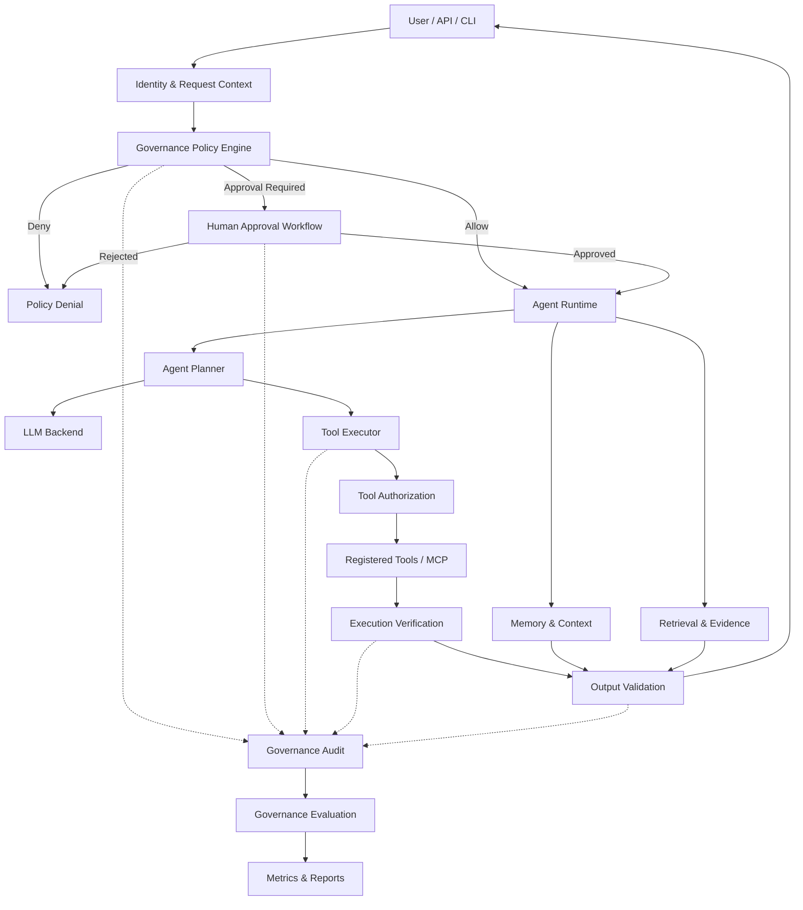
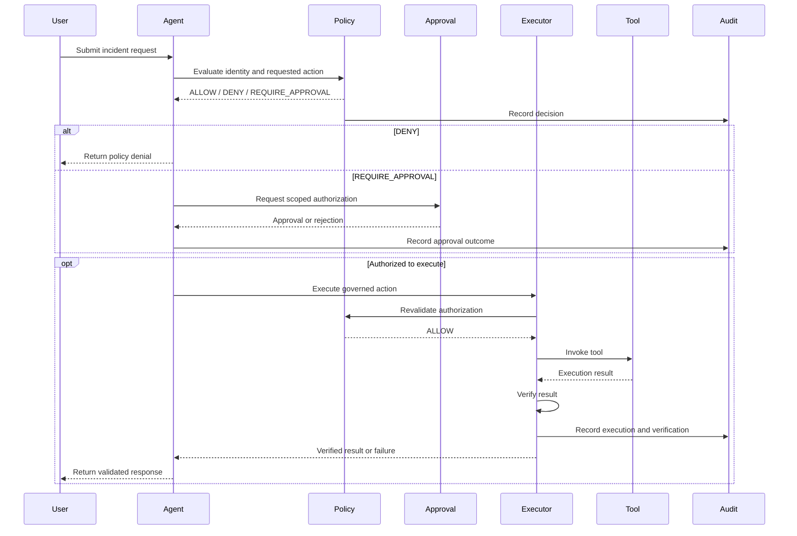

# Enterprise AI Agent Governance Architecture

**Project:** Enterprise Agent Engineering & Evaluation\
**Status:** Proposed Architecture — Not Yet Implemented\
**Architecture Approach:** Extend the existing agent framework with enforceable governance, security, approval, audit, and evaluation controls.

## 1. Executive Summary

The Enterprise Agent Engineering & Evaluation project demonstrates how AI agents investigate infrastructure incidents, execute controlled tools, manage context, collect evidence, and evaluate execution quality.

The next architectural enhancement is to introduce an enterprise AI governance layer that ensures agent decisions and actions are authorized, explainable, traceable, testable, and subject to human oversight.

The governance design follows five principles:

1. **Default deny:** Agents cannot execute unauthorized actions.
2. **Least privilege:** Each agent receives only the permissions necessary for its task.
3. **Human oversight:** High-risk actions require explicit, scoped approval.
4. **Independent enforcement:** Security decisions are enforced by trusted application code, not LLM instructions.
5. **Continuous evaluation:** Governance controls must be tested through deterministic and adversarial scenarios.

## 2. Proposed Architecture



**Architectural requirement:** The diagram represents logical responsibilities. It does not require a separate gateway service. The governance controls should initially be implemented within the existing Python application.

## 3. Existing Architecture and Governance Extensions

| Existing module            | Existing responsibility         | Proposed governance extension                              |
| -------------------------- | ------------------------------- | ---------------------------------------------------------- |
| `src/policy/engine.py`     | Tool authorization              | Structured policy decisions, risk levels, scoped approvals |
| `src/agents/runtime.py`    | Agent execution lifecycle       | Agent identity, governance context, decision trace         |
| `src/agents/planner.py`    | Tool planning                   | Risk-aware planning and prohibited-action handling         |
| `src/tools/permissions.py` | Default-deny permissions        | Role and resource-based authorization                      |
| `src/tools/executor.py`    | Tool execution and verification | Approval validation, execution isolation, audit hooks      |
| `src/tools/registry.py`    | Registered tool definitions     | Tool ownership, classification, allowed environments       |
| `src/mcp/`                 | MCP integration                 | Trusted server registry and tool boundary enforcement      |
| `src/memory/`              | Memory management               | Data classification, access control, retention             |
| `src/retrieval/`           | Knowledge retrieval             | Source authorization and provenance                        |
| `src/evidence/`            | Evidence collection             | Evidence integrity and traceability                        |
| `src/evaluation/`          | Agent evaluation                | Governance compliance metrics                              |
| `tests/`                   | Automated verification          | Governance, security, approval and adversarial tests       |

The existing policy and tool authorization components should remain the foundation of the design.

## 4. Governance Control Layers

### Layer 1 — Identity and Access Governance

**Objective:** Ensure every agent operation has an identifiable and authorized actor.

Proposed capabilities:

- User and agent identities.
- Role-based access control (RBAC).
- Resource and environment authorization.
- Least-privilege permission assignment.
- Trusted propagation of identity across agent and tool boundaries.

Example roles:

| Role          | Read incident | Investigate service | Restart production service |
| ------------- | ------------- | ------------------- | -------------------------- |
| Viewer        | Allow         | Deny                | Deny                       |
| Operator      | Allow         | Allow               | Approval required          |
| Administrator | Allow         | Allow               | Approval required          |

Administrative privileges should not automatically bypass high-risk action approval.

### Layer 2 — Policy Decision and Enforcement

**Objective:** Separate governance decisions from LLM-generated plans.

Proposed policy outcomes:

- `ALLOW`
- `DENY`
- `REQUIRE_APPROVAL`

A policy decision should include:

```json
{
  "decision": "REQUIRE_APPROVAL",
  "actor": "incident_agent",
  "action": "restart_service",
  "resource": "production-api",
  "environment": "prod",
  "risk_level": "HIGH",
  "reason_code": "PRODUCTION_MUTATION",
  "policy_version": "1.0"
}
```

The policy engine must evaluate authorization before execution. An approval requirement is not permission to execute until a trusted approval service validates the request.

### Layer 3 — Tool Execution Governance

**Objective:** Prevent unauthorized, unsafe, or unverifiable tool operations.

Controls:

- Tool allowlists.
- Argument schema validation.
- Environment restrictions.
- Tool-specific permissions.
- Execution timeouts.
- Execution budgets.
- Post-action verification.
- Isolation for mutating or untrusted tools.

The existing `ToolExecutor` provides a starting point.

A key improvement is enforceable cancellation: Python thread timeouts do not guarantee that an underlying operation has stopped. Risky operations should execute through isolated processes or external workers with bounded permissions.

### Layer 4 — Human Approval Governance

**Objective:** Keep consequential actions under accountable human control.

An approval record should include:

- Approval request identifier.
- Requesting actor and approving identity.
- Exact operation, resource, and normalized arguments.
- Environment and risk classification.
- Expiration timestamp.
- Single-use or explicitly bounded authorization.
- Approval or rejection decision.

Approval should be validated again immediately before execution to prevent stale or modified requests from bypassing governance.

### Layer 5 — Data, Memory, and Evidence Governance

**Objective:** Protect sensitive information and ensure evidence remains trustworthy.

Controls:

- Sensitive-data classification.
- PII and secret redaction.
- Memory access restrictions.
- Retention and deletion policies.
- Retrieval authorization.
- Source provenance.
- Evidence integrity checks.
- Explicit distinction between verified evidence and model-generated interpretation.

Retrieved documents and tool outputs must be treated as untrusted content, not as instructions that can override policy.

### Layer 6 — Audit and Observability

**Objective:** Make agent behavior reconstructable and accountable.

Proposed audit event:

```json
{
  "event_type": "TOOL_POLICY_DECISION",
  "trace_id": "example-trace-id",
  "actor": "incident_agent",
  "tool": "restart_service",
  "resource": "production-api",
  "decision": "REQUIRE_APPROVAL",
  "policy_version": "1.0",
  "reason_code": "PRODUCTION_MUTATION"
}
```

Production audit events should additionally include trusted timestamps, correlation identifiers, approval references where applicable, and integrity protections.

Audit records must not indiscriminately contain full prompts, credentials, personal information, or sensitive tool responses.

### Layer 7 — Continuous Governance Evaluation

**Objective:** Demonstrate that governance controls work under normal, abnormal, and adversarial conditions.

Suggested metrics:

| Metric                       | Expected target                         |
| ---------------------------- | --------------------------------------- |
| Unauthorized tool execution  | Zero successful unauthorized executions |
| Missing approval enforcement | Zero bypasses in tested scenarios       |
| Audit coverage               | 100% of tested governed decisions       |
| Policy decision consistency  | 100% for deterministic fixtures         |
| Post-action verification     | Required for all mutating tools         |
| Sensitive-data leakage       | Zero in defined security test fixtures  |

These are proposed acceptance criteria, not currently verified project results.

## 5. Governance Execution Lifecycle



## 6. Proposed Repository Additions

The following is a target structure, not a statement that these files already exist.

```text
src/
├── governance/
│   ├── __init__.py
│   ├── decisions.py
│   ├── identity.py
│   ├── approvals.py
│   ├── audit.py
│   └── risk.py
├── policy/
│   └── engine.py
├── agents/
├── tools/
├── memory/
├── retrieval/
├── evidence/
└── evaluation/
    └── governance_metrics.py

tests/
├── unit/
│   └── test_governance_policy.py
├── integration/
│   └── test_governed_tool_execution.py
└── scenarios/
    └── test_governance_scenarios.py

docs/
└── governance_architecture.md
```

**Design boundary:** `src/governance` provides shared identity, approval, risk, and audit capabilities. `src/policy` remains the authoritative policy decision layer, while `src/tools/executor.py` remains an enforcement point.

## 7. Implementation Roadmap

### Phase 1 — Policy Foundation

- Introduce structured policy decision results.
- Add actor and resource context.
- Add risk classification.
- Preserve default-deny behavior.
- Maintain compatibility with existing tools and tests.

**Exit criteria:** Unauthorized actions are consistently rejected through deterministic tests.

### Phase 2 — Approval and Audit

- Implement scoped, expiring approvals.
- Add approval validation before execution.
- Add structured audit events.
- Implement a persistent audit sink.
- Test rejected, expired, reused, and altered approvals.

**Exit criteria:** High-risk operations cannot proceed without valid authorization and generate auditable decisions.

### Phase 3 — Runtime and Data Protection

- Introduce isolation for risky tools.
- Enforce tool execution budgets.
- Add sensitive-data redaction.
- Enforce retrieval and memory access policies.
- Protect against prompt-injection attempts through untrusted tool outputs.

**Exit criteria:** Defined security scenarios demonstrate that agent instructions cannot bypass trusted enforcement.

### Phase 4 — Governance Evaluation

- Build deterministic governance datasets.
- Add negative and adversarial test scenarios.
- Track policy and approval failures.
- Produce governance reports.
- Add CI quality gates.

**Exit criteria:** Governance test suites run automatically and produce reproducible evidence.

## 8. Proposed Test Scenarios

| ID      | Scenario                                     | Expected result                |
| ------- | -------------------------------------------- | ------------------------------ |
| GOV-001 | Unauthorized tool request                    | DENY                           |
| GOV-002 | Missing required scope                       | DENY                           |
| GOV-003 | Tool called in prohibited environment        | DENY                           |
| GOV-004 | Production mutation without approval         | REQUIRE_APPROVAL; no execution |
| GOV-005 | Valid scoped approval                        | ALLOW                          |
| GOV-006 | Expired approval                             | DENY                           |
| GOV-007 | Reused single-use approval                   | DENY                           |
| GOV-008 | Approval arguments modified                  | DENY                           |
| GOV-009 | Tool result verification fails               | VERIFICATION_FAILED            |
| GOV-010 | Prompt injection attempts policy override    | DENY unauthorized action       |
| GOV-011 | Sensitive content appears in audit input     | Redacted audit event           |
| GOV-012 | Policy decision recorded                     | Auditable event exists         |
| GOV-013 | Untrusted MCP tool requests elevated access  | DENY                           |
| GOV-014 | Tool exceeds execution budget                | Controlled failure             |
| GOV-015 | Agent accesses unauthorized retrieval source | DENY                           |

Tests should verify actual enforcement and side effects, not only returned text or model explanations.

## 9. Alignment With Governance Frameworks

This architecture is intended to support engineering practices informed by:

- **NIST AI Risk Management Framework:** Govern, Map, Measure, Manage.
- **ISO/IEC 42001:** AI management system governance and accountability.
- **OWASP LLM security guidance:** Prompt injection, excessive agency, sensitive-information exposure, and tool misuse.

Framework alignment is a design objective. It does not constitute certification, regulatory compliance, or a completed security assessment.

## 10. Known Limitations

- Governance controls are proposed incrementally and are not all implemented.
- Existing in-memory execution traces are not equivalent to durable audit records.
- Thread-based timeout handling does not guarantee termination.
- Approval by tool name alone is insufficient for production authorization.
- Simulated incident tools cannot establish real-world operational safety.
- Deterministic test success does not eliminate unknown adversarial behaviors.
- Production deployment would require additional identity integration, secret management, operational monitoring, and independent security review.

## 11. Architecture Decision

**Decision:** Extend the existing Enterprise Agent Engineering & Evaluation repository with a modular governance layer.

**Rationale:** The repository already contains policy enforcement, tool permission checks, execution verification, agent traces, and evaluation infrastructure. Extending these capabilities avoids duplicating architectural responsibilities and provides a practical learning path toward governed enterprise AI agents.

**Future consideration:** After implementation and validation, reusable governance components may be extracted into a standalone Python package for other enterprise AI projects.

---

**Proposed outcome:** An enterprise AI agent framework in which agent actions are authorized, high-risk operations require accountable approval, execution results are verified, decisions are auditable, and governance behavior is continuously evaluated.
