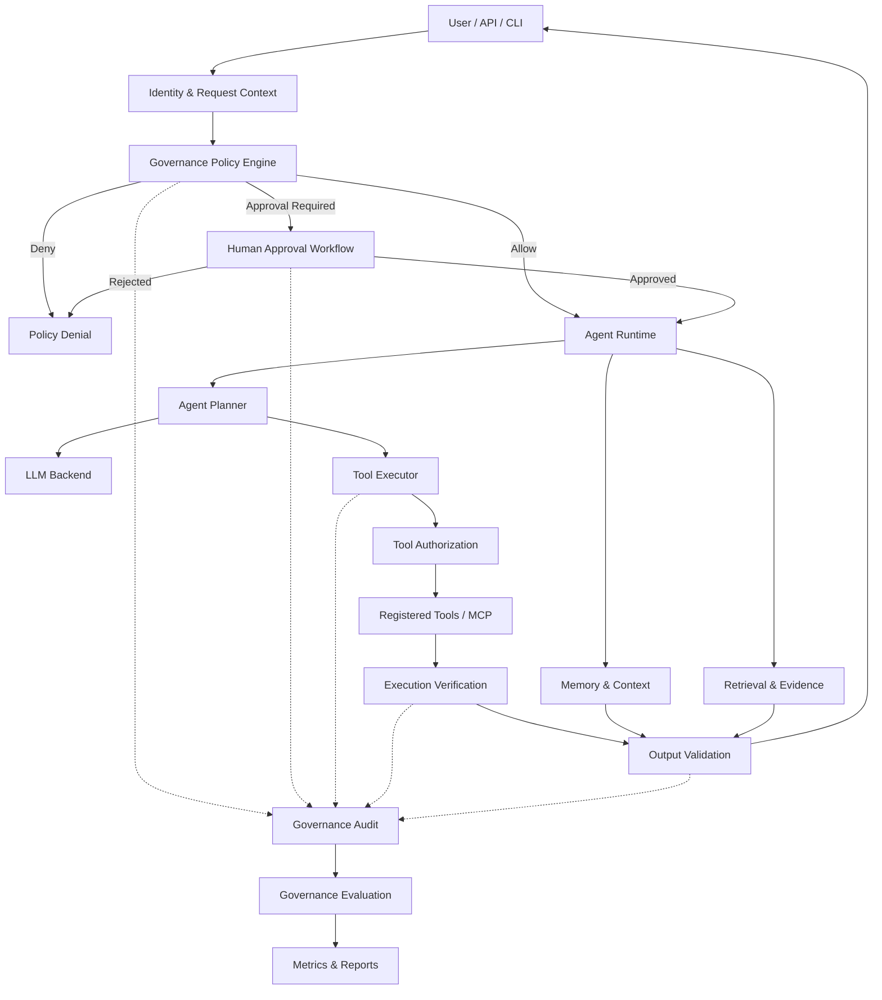
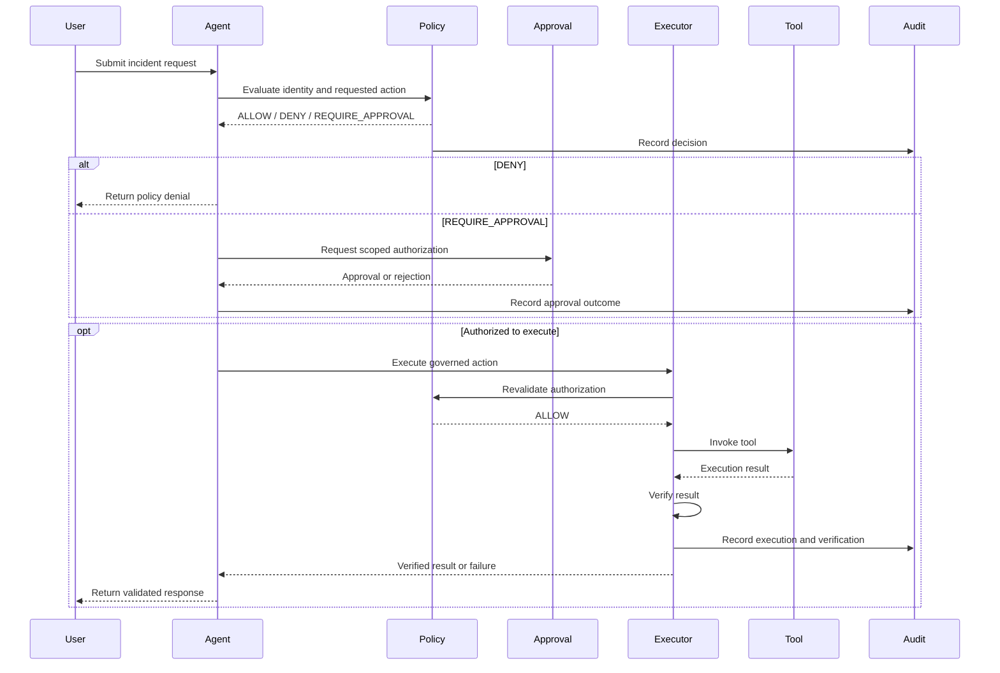

# Enterprise AI Agent Governance Architecture

**Project:** Enterprise Agent Engineering & Evaluation

**Status:** Partially implemented; design and remaining work tracked below

**Implementation review:** 2026-10-25

**Architecture Approach:** Extend the existing agent framework with enforceable governance, security, approval, audit, and evaluation controls.

## 1. Executive Summary

The Enterprise Agent Engineering & Evaluation project demonstrates how AI agents investigate infrastructure incidents, execute controlled tools, manage context, collect evidence, and evaluate execution quality.

The repository now implements a first governance slice in the standard `ToolExecutor`: structured host policy decisions, scoped and expiring approval checks, process isolation for mutating tools, and a persistent HMAC-chained audit sink. These controls are exercised with local fixture tools and deterministic tests. They are not an end-to-end production governance system. Identity integration, human approval issuance, one-time approval consumption, MCP policy integration, data access controls, and governance reporting remain pending.

The governance design follows five principles:

1. **Default deny:** Agents cannot execute unauthorized actions.
2. **Least privilege:** Each agent receives only the permissions necessary for its task.
3. **Human oversight:** High-risk actions require explicit, scoped approval.
4. **Independent enforcement:** Security decisions are enforced by trusted application code, not LLM instructions.
5. **Continuous evaluation:** Governance controls must be tested through deterministic and adversarial scenarios.

## 2. Target Architecture



**Architectural requirement:** This is a target design, not a diagram of completed integration. In particular, the identity service, human approval workflow, output validation, and governance metrics and reports are pending. The diagram does not require a separate gateway service; the first controls live in the existing Python application.

## 3. Existing Architecture and Governance Extensions

| Area | Implemented now | Pending |
| --- | --- | --- |
| `src/policy/engine.py` | `PolicyDecision` with allow/deny, reason, version, and approval reference; actor, scopes, environment, risk, resource argument, and exact argument digest checks | Distinct `REQUIRE_APPROVAL` decision, role model, authenticated identity and approval authority |
| `src/policy/audit.py` | Local durable JSONL sink with locked, synced appends and HMAC-chain verification; metadata-only records | Off-host storage or chain anchoring, retention, correlation IDs, audit operations and monitoring |
| `src/tools/permissions.py` | Tool-name default deny | Role and resource authorization beyond the policy engine's exact resource approval check |
| `src/tools/registry.py` | Risk, side-effect, scope, environment, approval, verifier, and resource-argument metadata | Tool ownership and data classification |
| `src/tools/executor.py` | Policy preflight, schema checks, mutation verification, process timeout for mutating handlers, audit hooks | Downstream cancellation and idempotency; untrusted plugin isolation; governed execution across all agent paths |
| `src/agents/runtime.py` and `planner.py` | Standard agent selects and invokes registered tools | Trusted actor propagation and risk-aware planning; runtime traces currently include arguments and answers |
| `src/mcp/` | Read-only fixture tools and a separate MCP allowlist | Unified host policy and audit enforcement, authenticated trusted-server registry |
| `src/memory/` and `src/retrieval/` | Local SQLite memory and cited runbook retrieval | Classification, access checks, redaction, retention, source authorization |
| `src/evidence/` | Run-local source-linked cards and citation checks in the replay investigator | Persistent evidence, integrity protection, broader provenance and claim validation |
| `src/evaluation/` and `tests/` | Deterministic policy, audit, timeout, budget, and replay-process checks | Governance dataset, coverage and leakage metrics, adversarial suite, dedicated reports and CI gate |

The existing policy and tool authorization components should remain the foundation of the design.

## 4. Governance Control Layers

### Layer 1 — Identity and Access Governance

**Objective:** Ensure every agent operation has an identifiable and authorized actor.

**Current status: Partial.** `PolicyContext.actor_id` identifies a caller for mutating tool checks, and scopes and environment are enforced by host code. The caller supplies that identity; the repository has no login or identity-provider integration, role mapping, or trusted propagation through every agent path. Read-only calls may use the default `anonymous` actor.

Proposed capabilities:

- User and agent identities.
- Role-based access control (RBAC).
- Resource and environment authorization.
- Least-privilege permission assignment.
- Trusted propagation of identity across agent and tool boundaries.

Example roles:

| Role          | Read incident | Investigate service | Restart production service |
| ------------- | ------------- | ------------------- | -------------------------- |
| Viewer        | Allow         | Deny                | Deny                       |
| Operator      | Allow         | Allow               | Approval required          |
| Administrator | Allow         | Allow               | Approval required          |

Administrative privileges should not automatically bypass high-risk action approval.

### Layer 2 — Policy Decision and Enforcement

**Objective:** Separate governance decisions from LLM-generated plans.

**Current status: Partial.** `src/policy/engine.py` returns a versioned `PolicyDecision` with `allowed`, a reason code, and an optional approval reference. The executor denies calls that need an approval but lack one. `REQUIRE_APPROVAL` is not yet a distinct runtime outcome that starts an approval workflow. The JSON below is a target shape, not the current Python decision schema.

Proposed policy outcomes:

- `ALLOW`
- `DENY`
- `REQUIRE_APPROVAL`

A policy decision should include:

```json
{
  "decision": "REQUIRE_APPROVAL",
  "actor": "incident_agent",
  "action": "restart_service",
  "resource": "production-api",
  "environment": "prod",
  "risk_level": "HIGH",
  "reason_code": "PRODUCTION_MUTATION",
  "policy_version": "1.0"
}
```

The policy engine must evaluate authorization before execution. An approval requirement is not permission to execute until a trusted approval service validates the request.

### Layer 3 — Tool Execution Governance

**Objective:** Prevent unauthorized, unsafe, or unverifiable tool operations.

**Current status: Partial.** The standard `ToolExecutor` enforces an allowlist, schema, scopes, environment, mutation opt-in, verifier, and audit requirement. Mutating handlers and verifiers run in a forked process that is terminated on timeout; read-only handlers still use threads. The replay investigator has call-count and wall-time budgets, but these are not a universal executor budget. The MCP agent follows a separate path and does not use this policy engine or audit sink.

Controls:

- Tool allowlists.
- Argument schema validation.
- Environment restrictions.
- Tool-specific permissions.
- Execution timeouts.
- Execution budgets.
- Post-action verification.
- Isolation for mutating or untrusted tools.

Child-process termination cannot roll back an external change already sent, stop remote work, or guarantee termination of descendant processes. The fork boundary is POSIX-specific and is not a full sandbox for untrusted code. See [governance hardening](governance_hardening.md).

### Layer 4 — Human Approval Governance

**Objective:** Keep consequential actions under accountable human control.

**Current status: Partial enforcement; workflow pending.** The `Approval` value is bound to actor, operation, resource, canonical argument digest, and expiry. The host checks it immediately before a governed tool call. No authenticated approver identity, issuance service, signature, revocation, rejection record, environment/risk binding, or single-use consumption exists. An exact request can reuse an approval until it expires.

An approval record should include:

- Approval request identifier.
- Requesting actor and approving identity.
- Exact operation, resource, and normalized arguments.
- Environment and risk classification.
- Expiration timestamp.
- Single-use or explicitly bounded authorization.
- Approval or rejection decision.

Approval should be validated again immediately before execution to prevent stale or modified requests from bypassing governance.

### Layer 5 — Data, Memory, and Evidence Governance

**Objective:** Protect sensitive information and ensure evidence remains trustworthy.

**Current status: Partial provenance; protection pending.** The replay investigator creates source-linked evidence cards and checks citations against its run-local results. SQLite memory stores requests, answers, and tool results; runbook retrieval adds cited text. Neither path enforces data classification, redaction, retention, or source-level access control. Tool outputs and retrieved text have no general prompt-injection defense beyond host-side tool authorization.

Controls:

- Sensitive-data classification.
- PII and secret redaction.
- Memory access restrictions.
- Retention and deletion policies.
- Retrieval authorization.
- Source provenance.
- Evidence integrity checks.
- Explicit distinction between verified evidence and model-generated interpretation.

Retrieved documents and tool outputs must be treated as untrusted content, not as instructions that can override policy.

### Layer 6 — Audit and Observability

**Objective:** Make agent behavior reconstructable and accountable.

**Current status: Partial.** `AuditSink` persists policy and execution metadata for calls made through a configured `ToolExecutor`. Mutating calls require a sink; read-only calls do not. Records include timestamp, policy version, actor, operation, environment, decision, reason, approval reference, outcome status, duration, sequence, and HMAC chain links. The example below is a target event; the implemented event has no trace ID or resource field and uses `allow`/`deny` decisions. Prompt, argument, result body, and exception text are omitted from the audit record.

Proposed audit event:

```json
{
  "event_type": "TOOL_POLICY_DECISION",
  "trace_id": "example-trace-id",
  "actor": "incident_agent",
  "tool": "restart_service",
  "resource": "production-api",
  "decision": "REQUIRE_APPROVAL",
  "policy_version": "1.0",
  "reason_code": "PRODUCTION_MUTATION"
}
```

Production audit operations still need trusted identity, correlation identifiers, key management, retention, off-host chain anchoring, and monitoring. The local HMAC chain detects edits to retained records but cannot detect deletion or full-file replacement without an external anchor.

Audit records must not indiscriminately contain full prompts, credentials, personal information, or sensitive tool responses.

### Layer 7 — Continuous Governance Evaluation

**Objective:** Demonstrate that governance controls work under normal, abnormal, and adversarial conditions.

**Current status: Partial.** Unit and scenario tests cover several policy denials, exact approval matching, audit tampering, and mutation timeout behavior. Replay-process tests cover call budgets and citations. The general CI workflow runs all tests, but there is no dedicated governance coverage report, security dataset, or governance-specific release gate.

Suggested metrics:

| Metric                       | Expected target                         |
| ---------------------------- | --------------------------------------- |
| Unauthorized tool execution  | Zero successful unauthorized executions |
| Missing approval enforcement | Zero bypasses in tested scenarios       |
| Audit coverage               | 100% of tested governed decisions       |
| Policy decision consistency  | 100% for deterministic fixtures         |
| Post-action verification     | Required for all mutating tools         |
| Sensitive-data leakage       | Zero in defined security test fixtures  |

These targets are design criteria, not measured project-wide results. Passing local deterministic tests does not establish zero unauthorized execution or leakage across every agent path.

## 5. Governance Execution Lifecycle



## 6. Target Repository Additions

The following is a possible later package layout, not the current tree. The implemented `PolicyDecision` and `Approval` live in `src/policy/engine.py`; `AuditSink` lives in `src/policy/audit.py`. The current tests are `tests/unit/test_governance.py`, `tests/unit/test_policy_and_investigation.py`, and `tests/scenarios/test_governance_scenario.py`. There is no `src/governance/` package. A namespace move is optional and should follow stable interfaces, not precede missing controls.

```text
src/
├── governance/
│   ├── __init__.py
│   ├── decisions.py
│   ├── identity.py
│   ├── approvals.py
│   ├── audit.py
│   └── risk.py
├── policy/
│   └── engine.py
├── agents/
├── tools/
├── memory/
├── retrieval/
├── evidence/
└── evaluation/
    └── governance_metrics.py

tests/
├── unit/
│   └── test_governance_policy.py
├── integration/
│   └── test_governed_tool_execution.py
└── scenarios/
    └── test_governance_scenarios.py

docs/
└── governance_architecture.md
```

**Design boundary:** If a shared `src/governance` package is introduced later, `src/policy` should remain the authoritative policy decision layer and `src/tools/executor.py` an enforcement point. Today, the standard executor is the only path using the new policy and audit components; MCP has a separate allowlist.

## 7. Implementation Roadmap

### Phase 1 — Policy Foundation

- **Implemented:** Versioned `PolicyDecision` with allow/deny and reason; actor ID, scopes, environment, risk metadata, resource-argument binding for approvals, and default-deny mutation checks. Existing standard tool tests pass.
- **Pending:** Authenticated actor source, role/resource authorization beyond an exact approved resource, and a distinct `REQUIRE_APPROVAL` outcome for workflow integration.

**Exit criteria: Partially met.** Deterministic tests cover selected unauthorized standard tool calls; the whole agent surface is not covered.

### Phase 2 — Approval and Audit

- **Implemented:** Exact actor/operation/resource/arguments/expiry matching before execution; metadata-only, HMAC-chained JSONL audit sink; tests for mismatched and expired approvals, missing or corrupted audit, and a legacy tool-name allowance.
- **Pending:** Approval issuance and approver identity, rejection/revocation, one-time consumption or bounded reuse, environment and risk binding in the approval record, off-host audit anchoring, key lifecycle, retention, and cross-path audit coverage.

**Exit criteria: Partially met.** This holds for governed calls through `ToolExecutor` with a trusted host-supplied context and configured sink. It has not been established for MCP or a production write adapter.

### Phase 3 — Runtime and Data Protection

- **Implemented:** Forked child execution for mutating tools with timeout termination; call-count and wall-time budgets for the replay investigator; metadata-only tool audit events.
- **Pending:** Downstream cancellation and idempotency, untrusted-code sandboxing, universal per-call budgets, sensitive-data classification and redaction, memory and retrieval access policies, and prompt-injection tests across tool and retrieval content.

**Exit criteria: Not met.** The current negative cases do not establish coverage of all untrusted inputs or agent paths.

### Phase 4 — Governance Evaluation

- **Implemented:** Focused unit and one scenario-level governance test, plus replay process checks. The general CI workflow runs the test suite.
- **Pending:** Versioned governance scenario dataset, broad adversarial cases, policy/approval failure metrics, sensitive-data leakage measurements, dedicated reports, and explicit governance CI thresholds.

**Exit criteria: Partially met.** Tests run in general CI, but there is no dedicated governance report or gate.

## 8. Governance Scenario Coverage

`Covered` means a deterministic local test checks the stated result; it is not a production security claim. `Partial` means a narrower behavior is tested. The named `GOV` cases are a tracking catalog, not a committed test fixture dataset.

| ID | Scenario | Status | Evidence or remaining test |
| --- | --- | --- | --- |
| GOV-001 | Unauthorized tool request | Covered | `tests/unit/test_tool_calling.py` and `test_policy_and_investigation.py` deny disallowed tools and default mutations. |
| GOV-002 | Missing required scope | Covered | `test_policy_and_investigation.py` denies a high-risk call before the handler when its required scope is absent. |
| GOV-003 | Tool in prohibited environment | Pending test | Engine checks `tool.environments`; add an execution-level denial test. |
| GOV-004 | Production mutation without approval | Partial | Missing approval is denied, but the existing test also lacks a trusted actor; add a case isolating approval as the sole missing requirement. No `REQUIRE_APPROVAL` workflow response exists. |
| GOV-005 | Valid scoped approval | Covered | Unit and scenario tests execute only the exact approved call and verify the result. |
| GOV-006 | Expired approval | Covered | `tests/unit/test_governance.py` denies an expired approval. |
| GOV-007 | Reused single-use approval | Pending | Approvals are reusable for the same exact call until expiry; add consumption storage and a replay test. |
| GOV-008 | Modified approval arguments | Covered | Actor, operation, resource, and argument mismatch cases are denied in `test_governance.py`. |
| GOV-009 | Verification failure | Covered | `test_policy_and_investigation.py` returns `verification_failed` for a rejected post-action verifier. |
| GOV-010 | Prompt injection attempts policy override | Pending | Add hostile tool-output and retrieval fixtures that request prohibited actions. |
| GOV-011 | Sensitive content in audit input | Partial | Audit tests check that tool payload keys are omitted; no comprehensive PII/secret redaction tests cover metadata fields or other traces. |
| GOV-012 | Policy decision recorded | Covered | `test_governance.py` verifies decision and outcome records and detects record tampering. |
| GOV-013 | Untrusted MCP tool requests elevated access | Partial | `tests/integration/test_mcp.py` checks an MCP allowlist denial, but there is no trusted-server registry or unified policy evaluation. |
| GOV-014 | Tool exceeds execution budget | Partial | Replay call budgets and mutation timeout termination are tested; no universal budget applies to every tool path. |
| GOV-015 | Unauthorized retrieval source | Pending | The runbook retriever has no per-source authorization. |

Tests should verify actual enforcement and side effects, not only returned text or model explanations.

## 9. Alignment With Governance Frameworks

This architecture is intended to support engineering practices informed by:

- **NIST AI Risk Management Framework:** Govern, Map, Measure, Manage.
- **ISO/IEC 42001:** AI management system governance and accountability.
- **OWASP LLM security guidance:** Prompt injection, excessive agency, sensitive-information exposure, and tool misuse.

Framework alignment is a design objective. It does not constitute certification, regulatory compliance, or a completed security assessment.

## 10. Known Limitations

- Governance is enforced in the standard `ToolExecutor`; the MCP path and direct handler calls do not share that policy and audit boundary.
- `PolicyContext`, actor IDs, approval records, and audit keys must come from trusted host code. No identity provider or approval service verifies their origin.
- Scoped approvals can be reused for an identical call until expiry and have no revocation or single-use guarantee.
- The HMAC audit sink is local and optional for reads. It omits sensitive payloads, but other agent traces and SQLite memory may store requests, answers, arguments, and tool results. Chain truncation or replacement needs an external anchor to detect.
- Read-only thread timeouts cannot stop handlers. Mutating child-process termination cannot undo external side effects or stop remote work already started.
- Replay evidence cards are run-local and source-linked but not independently integrity protected. Retrieval and memory lack classification, source authorization, and retention controls.
- Simulated incident tools cannot establish real-world operational safety.
- Deterministic test success does not eliminate unknown adversarial behaviors.
- Production deployment would require additional identity integration, secret management, operational monitoring, and independent security review.

## 11. Architecture Decision

**Decision:** Extend the existing Enterprise Agent Engineering & Evaluation repository with a modular governance layer.

**Rationale:** The repository already contains policy enforcement, tool permission checks, execution verification, agent traces, and evaluation infrastructure. Extending these capabilities avoids duplicating architectural responsibilities and provides a practical learning path toward governed enterprise AI agents.

**Future consideration:** After implementation and validation, reusable governance components may be extracted into a standalone Python package for other enterprise AI projects.

---

**Target outcome:** An enterprise AI agent framework in which actions across every execution path are authorized, high-risk operations receive accountable human approval, execution results are verified, decisions are durably auditable, and governance behavior is continuously evaluated. The current implementation establishes only the bounded standard-tool foundation described above.
