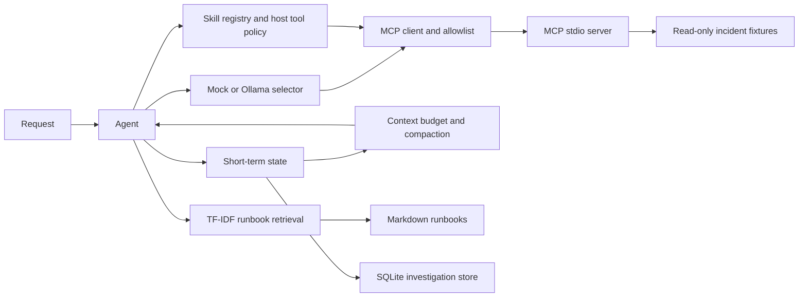

# Architecture through Lecture 7 and the simulation milestone

The local incident agent in `src/agents/runtime.py` exercises tool calling
without MCP. `MCPIncidentAgent` discovers server tools and invokes only
allowed names. `StatefulMCPIncidentAgent` adds SQLite-backed resume, and
`RetrievalIncidentAgent` adds runbook sections before the answer is persisted.
The default selector is deterministic for offline experiments; the optional
Ollama backend uses a locally running model.

The phase 6.6 coding agent runs generated scripts only through a constrained
Docker container. Phase 6.7 skill manifests compose the MCP client with a
per-skill tool list and a separate host permission policy.

Each phase has an experiment in `experiments/lecture_06/` and focused tests
under `tests/`.

The simulation milestone adds `simulation/` as a separate replay and tool
adapter package. Its public event dataset feeds a baseline investigator
through `ToolExecutor`; private labels are loaded only by the evaluation
runner. See [Simulation](simulation.md) for the boundary and limitations.
