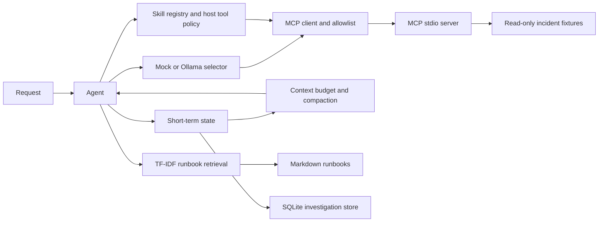

# Architecture through Lecture 7 and the simulation milestone

The local incident agent in `src/agents/runtime.py` exercises tool calling
without MCP. `MCPIncidentAgent` discovers server tools and invokes only
allowed names. `StatefulMCPIncidentAgent` adds SQLite-backed resume, and
`RetrievalIncidentAgent` adds runbook sections before the answer is persisted.
The default selector is deterministic for offline experiments; the optional
Ollama backend uses a locally running model.

The phase 6.6 coding agent runs generated scripts only through a constrained
Docker container. Phase 6.7 skill manifests compose the MCP client with a
per-skill tool list and a separate host permission policy.

Each phase has an experiment in `experiments/lecture_06/` and focused tests
under `tests/`.

The simulation milestone adds `simulation/` as a separate replay and tool
adapter package. Its public event dataset feeds a baseline investigator
through `ToolExecutor`; private labels are loaded only by the evaluation
runner. See [Simulation](simulation.md) for the boundary and limitations.

The replay investigator now uses a bounded lifecycle in
`src/agents/investigation.py`. When it uses the standard `ToolExecutor`, every
attempted tool call passes the host policy in `src/policy/engine.py` and the
executor's name allowlist and input schema checks. Successful observations
become source-linked cards in `src/evidence/`; answer observations cite their card IDs. The run record
captures ordered events and can be exported as JSONL. The
[comparison document](architecture_improvement_comparison.md) maps the review's
target structure to the paths actually changed.

These are separate agent paths: the replay investigator does not currently
use Ollama, MCP, retrieval, or SQLite memory. Its evidence cards and raw tool
results remain in memory, and the explicit JSONL export contains events only.
The MCP agent has its own allowlist rather than the replay executor's host
policy. See the
[implementation maturity review](../reports/implementation_maturity_review_2026-10-17.md)
for tested behavior and remaining boundaries.
