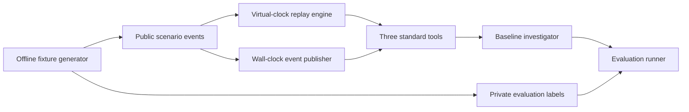

# Simulation and validation: first milestone

The replay layer provides time-bounded infrastructure observations for agent
investigations. It is separate from the agent implementation and evaluation
labels.



`simulation/event_generator.py` deterministically writes 20 scenarios to
`data/simulation/scenarios.jsonl` and labels to
`data/evaluation_datasets/simulation_ground_truth.jsonl`. Runtime replay
loads only the public file. The evaluator joins labels after an agent run. The
agent receives a `ToolExecutor` with three read-only contracts:

| Tool | Input | Observation |
| --- | --- | --- |
| `get_incident_record` | `incident_id` | Alert summary, service, server, status |
| `get_server_metrics` | `server_id` | Available metric samples through current virtual minute |
| `get_application_logs` | `service` | Log entries through current virtual minute |

Most scenarios have observations at minutes 0, 5, 10, and 15. `SIM-004` has
eight observations from 10:00 through 10:35 UTC at five-minute intervals. The virtual clock
can seek or advance without waiting for wall time. It prevents future metric
and log events from appearing in tool responses. Scenarios include CPU and
memory pressure, database and network faults, deployment regression, missing
telemetry, timeout, conflicting signals, recovery, repeated alerts, permission
denial, and healthy operation. The permission scenario removes metric access
through the standard executor policy. The original tiny fixtures remain in place for
fast unit tests.

Run from the repository root:

```sh
python3 -m simulation.event_generator
python3 -m scripts.run_simulation
python3 -m scripts.validate_mode_a
python3 -m unittest tests.unit.test_simulation tests.integration.test_simulation_agent -v
```

The runner writes `reports/scenario_results/replay.json`. Tool coverage counts
expected tool names regardless of order; multiple valid trajectories remain
possible. The literal root-cause phrase rate only checks whether the exact
label string appears in the answer. It is **not** semantic root-cause accuracy.
The baseline investigator summarizes observations and does not diagnose most
causes; this gives a meaningful starting point for later agent improvements.

The initial local replay has 20 scenarios and 60 attempted tool calls. All
expected tool names were selected; 58 of 60 calls succeeded. One metric call
timed out and one was denied by policy. The exact root-cause label appeared in
zero answers, which establishes the baseline's current diagnosis gap rather
than an accuracy estimate.

The Mode A acceptance check replays `SIM-004` at virtual minutes 15, 25, and
35. It verifies that later events remain hidden, evidence and advice change as
the incident develops, and the final status is resolved. `--minute 15` (or
`25` or `35`) prints a single observation and agent answer. The fixed replay
does not wait for real time.

Mode B (`simulation/live.py`) publishes the same public event stream one event
per configurable wall-clock interval. The first event is available immediately.
Each poll creates a frozen replay engine containing only events published at
poll start and runs the baseline investigator in a worker thread. Concurrent
pollers therefore cannot mix observations from different virtual minutes in
one investigation. `python3 -m scripts.validate_mode_b` runs three concurrent
pollers and checks pacing, published event order, snapshot consistency, and
final recovery. Its JSON report lists the minutes each poller actually saw.
`--interval`, `--poll-interval`, and `--clients` change the load. Slow pollers
may miss short-lived states, which is an expected property of polling.

The file separation is an architectural data boundary, not a security sandbox.
A future untrusted agent needs process or service isolation so it cannot read
the evaluation files or inspect in-process tool handlers.

Fresh event synthesis during a run, large-scale data volumes, multiple seeds,
holdout scenarios, and stronger groundedness judging are later milestones.
