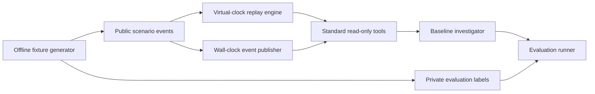

# Simulation and validation: first milestone

The replay layer provides time-bounded infrastructure observations for agent
investigations. It is separate from the agent implementation and evaluation
labels.



`simulation/event_generator.py` deterministically writes 25 scenarios to
`data/simulation/scenarios.jsonl` and labels to
`data/evaluation_datasets/simulation_ground_truth.jsonl`. Runtime replay
loads only the public file. The evaluator joins labels after an agent run. The
agent receives a `ToolExecutor` with six read-only contracts:

| Tool | Input | Observation |
| --- | --- | --- |
| `get_incident_record` | `incident_id` | Alert summary, service, server, status |
| `get_server_metrics` | `server_id` | Available metric samples through current virtual minute |
| `get_application_logs` | `service` | Log entries through current virtual minute |
| `get_pod_events` | `pod` | Kubernetes pod events through current virtual minute |
| `get_service_network_metrics` | `service` | Peer latency samples through current virtual minute |
| `get_database_metrics` | `database_id` | Connection-pool utilization and waiting requests through current virtual minute |

Most scenarios have observations at minutes 0, 5, 10, and 15. `SIM-004` has
eight observations from 10:00 through 10:35 UTC at five-minute intervals. The virtual clock
can seek or advance without waiting for wall time. It prevents future metric
and log events from appearing in tool responses. Scenarios include CPU and
memory pressure, database and network faults, deployment regression, missing
telemetry, timeout, conflicting signals, recovery, repeated alerts, permission
denial, and healthy operation. `SIM-006` adds pod events, `SIM-007` and
`SIM-025` add peer network samples, `SIM-004` adds database-pool samples and
request latency, and `SIM-010` exposes a second incident ID
with service-specific logs. These observations use the same permission checks
and future-event bounds as the original tools. The permission scenario removes
metric access through the standard executor policy. The original tiny fixtures
remain in place for fast unit tests. See the [scenario catalog](scenario_catalog.md)
for all 25 cases and their evaluation expectations.

Run from the repository root:

```sh
python3 -m simulation.event_generator
python3 -m scripts.run_simulation
python3 -m scripts.validate_mode_a
python3 -m scripts.validate_database_latency
python3 -m unittest tests.unit.test_simulation tests.integration.test_simulation_agent tests.integration.test_scenario_catalog -v
```

The runner writes `reports/scenario_results/replay.json`, including each private
rubric and the agent's observed answer. The literal cause check excludes cases
without a confirmed cause. Tool coverage counts
expected tool names regardless of order; multiple valid trajectories remain
possible. The literal root-cause phrase rate only checks whether the exact
label string appears in the answer. It is **not** semantic root-cause accuracy.
The baseline investigator summarizes observations and does not diagnose most
causes; this gives a meaningful starting point for later agent improvements.

The 25-case replay records 81 attempted tool calls, with 79 successes. All
expected tool names were selected. One metrics call timed out and one was
denied by policy. The exact root-cause label appeared in one of 19 causal
answers (the payment case). That
rate is a narrow string check, not a measure of whether the agent fulfilled
the case-specific behavior rubric.

The Mode A acceptance check replays `SIM-004` at virtual minutes 15, 25, and
35. It verifies that later events remain hidden, evidence and advice change as
the incident develops, and the final status is resolved. `--minute 15` (or
`25` or `35`) prints a single observation and agent answer. The fixed replay
does not wait for real time.

The dedicated payment evaluator runs four variants of `SIM-004` at minute 25:
baseline, missing database metrics, a database-tool timeout, and misleading
logs. The baseline conclusion is a cited *likely* cause. Missing or failed
database telemetry produces an insufficient-evidence finding despite an error
log naming pool exhaustion. Misleading logs are reported as conflicting with
the measured pool state. See the [outcome report](../reports/database_latency_scenario_2026-10-17.md).

Mode B (`simulation/live.py`) publishes the same public event stream one event
per configurable wall-clock interval. The first event is available immediately.
Each poll creates a frozen replay engine containing only events published at
poll start and runs the baseline investigator in a worker thread. Concurrent
pollers therefore cannot mix observations from different virtual minutes in
one investigation. `python3 -m scripts.validate_mode_b` runs three concurrent
pollers and checks pacing, published event order, snapshot consistency, and
final recovery. Its JSON report lists the minutes each poller actually saw.
`--interval`, `--poll-interval`, and `--clients` change the load. Slow pollers
may miss short-lived states, which is an expected property of polling.

The file separation is an architectural data boundary, not a security sandbox.
A future untrusted agent needs process or service isolation so it cannot read
the evaluation files or inspect in-process tool handlers.

Fresh event synthesis during a run, large-scale data volumes, multiple seeds,
holdout scenarios, and stronger groundedness judging are later milestones.

## Declarative synthetic scenarios

The five files in `simulation/scenarios/` are public scenario blueprints for
normal operation, CPU saturation, memory growth, database failure, and network
latency. They use JSON syntax, which is valid YAML, to avoid a runtime YAML
dependency. `simulation/generators/` validates infrastructure IDs, incident
alerts, numeric metrics, and log entries, then creates timestamped public
events. `python3 -m scripts.generate_synthetic` atomically validates and writes
`data/synthetic/scenarios.jsonl`. No private root-cause or expected-answer
labels are accepted in these blueprints.

`SimulationStateManager` holds an independent virtual minute per scenario and
returns frozen, time-bounded `ReplayEngine` snapshots. Its `tools()` method
creates the same `ToolExecutor` used by the agent. The incident, metric, and
log adapters register the existing tool names and JSON input schemas;
caller-supplied permissions can only narrow scenario permissions. The agent
does not need a separate simulation interface.

```sh
python3 -m scripts.generate_synthetic
python3 -m scripts.run_synthetic SYN-002 --minute 5
python3 -m scripts.run_synthetic SYN-002 --minute 15
python3 -m scripts.validate_synthetic_load
python3 -m unittest tests.scenarios.test_synthetic_blueprints tests.load.test_simulation_load -v
```

The first investigation sees only events through minute 5. The second also
sees sustained high CPU and the later failure log. The scenario tests verify
deterministic generation, label rejection, schema errors, permissions, and
agent integration. The load test performs 10 concurrent and 50 sequential
local reads with consistent snapshot times. These are functional workloads,
not capacity benchmarks. The load report is written to
`reports/reliability/synthetic_load.json`.

## Dataset progression

Stage 1 is this controlled synthetic data and the existing 25-case replay.
Stage 2 has a user-data import path, with no bundled public dataset. The
`scripts.import_public_logs` command takes a user-provided JSONL file and a
field mapping. It normalizes UTC timestamp, service, severity, and message to
`data/imported/`, which Git ignores. This prepares a log observation source
for later scenario construction; it does not create incident timelines or
private root-cause labels. Selected LogHub HDFS or BGL logs, or observations
from an OpenTelemetry demo, need source-specific parsing before they fit this
JSONL mapping. Review their licenses and data fields when you choose a source.

```sh
python3 -m scripts.import_public_logs path/to/your/logs.jsonl \
  --mapping configs/public_logs.example.json \
  --output data/imported/my_dataset/logs.jsonl
```

Stage 3 has an optional local prototype. `compose.yaml` enables a single
lightweight Python service under the `live-demo` profile. It uses SQLite to
record healthy, database-failure, and recovery events. The host port is bound
to loopback, and the agent reads incident, metrics, and logs through the same
tool names and schemas as replay. Fault injection is a separate control route;
the agent never receives a hidden cause label. The Compose profile keeps this
container out of the default setup.

```sh
docker compose --profile live-demo up --build -d
python3 -m scripts.run_live_demo
python3 -m scripts.inject_live_fault database_failure
python3 -m scripts.run_live_demo
python3 -m scripts.inject_live_fault recovered
python3 -m scripts.run_live_demo
docker compose --profile live-demo down
```

The SQLite named volume persists between runs. Use `docker compose --profile
live-demo down -v` only when you intend to erase this demo state. The local
prototype does not include a separate database server, observability stack,
production authentication, or an evaluation dataset. These remain future
Stage 3 work; no Stage 3 accuracy score is reported.
